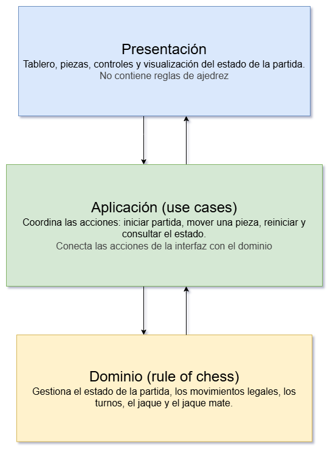

# Arquitectura

## 1. Visión general

Chess Game utiliza una arquitectura en capas para separar las responsabilidades de la presentación, la aplicación y el dominio.

Esta separación permite mantener la lógica del ajedrez independiente de la interfaz, facilita las pruebas y mejora la mantenibilidad del sistema.

## 2. Estilo arquitectónico

Se adopta una arquitectura en capas (Layered Architecture), organizada en tres capas principales.

- *Presentación*: gestiona la interfaz y la interacción con los jugadores.
- *Aplicación*: coordina los casos de uso y las operaciones de la partida.
- *Dominio*: concentra la lógica y las reglas del ajedrez.

Cada capa tiene responsabilidades definidas y se comunica con las demás respetando las reglas de dependencia establecidas.

## 3. Diagrama de arquitectura



El diagrama presenta las capas del sistema, sus responsabilidades y las relaciones entre ellas.

## 4. Capas arquitectónicas

### 4.1. Presentación

Es responsable de mostrar el tablero, las piezas, los turnos y el estado de la partida, además de capturar las acciones de los jugadores.

**Responsabilidades**

- Renderizar el tablero y sus componentes visuales.
- Capturar las acciones de los jugadores.
- Mostrar el estado y los resultados de las operaciones.
- Comunicar las acciones del usuario a la capa de aplicación.

Esta capa no contiene las reglas del ajedrez ni accede directamente al motor de reglas.

### 4.2. Aplicación

Es responsable de coordinar los casos de uso y conectar las acciones con la lógica del dominio.

**Responsabilidades**

- Iniciar y reiniciar una partida.
- Gestionar las solicitudes de movimientos
- Consultar el estado actual de la partida
- Coordinar las operaciones necesarias para actualizra la información presentada

Esta capa no implementa las reglas del ajedrez, delega su ejecución a la capa de dominio

#### 4.2.1. Contratos de las operaciones

Los siguientes contratos corresponden a los [requisitos funcionales de la versión local](requirements/functional-requirements.md). Se implementan en [apps/web/src/application/game-service.js](../apps/web/src/application/game-service.js), con pruebas en [apps/web/tests/application/game-service.test.js](../apps/web/tests/application/game-service.test.js). `GameService` coordina una partida mediante operaciones síncronas y delega su comportamiento en `Game`.

La aplicación mantiene la referencia a la única partida local. Antes de iniciarla, esa referencia está ausente. Las operaciones se procesan en orden, completando una antes de atender la siguiente.

| Operación | Entrada | Coordinación | Resultado esperado | Requisitos |
| --- | --- | --- | --- | --- |
| `startGame` | Ninguna. | Crea la primera partida; si ya existe, reutiliza el comportamiento de reinicio de `resetGame`. | `COMPLETED` con el estado inicial. | RF-01, RF-07 |
| `getGameState` | Ninguna. | Consulta la partida sin modificarla. | Estado actual o ausencia explícita de partida. | RF-05, RF-06 |
| `makeMove` | `from` y `to`: casillas de origen y destino en notación algebraica, por ejemplo `e2` y `e4`. | Comprueba que exista partida y solicita el movimiento al dominio. | `COMPLETED`, `PROMOTION_PENDING` o `REJECTED`, con el estado correspondiente. | RF-02, RF-03, RF-04, RF-05, RF-06 |
| `resolvePromotion` | `piece`: una de `queen`, `rook`, `bishop` o `knight`. | Comprueba que exista partida y solicita al dominio resolver la promoción pendiente con la pieza elegida. | `COMPLETED` o `REJECTED`, con el estado correspondiente. | RF-04, RF-05, RF-06 |
| `resetGame` | Ninguna. | Comprueba que exista partida y solicita su reinicio, incluso si está finalizada o tiene promoción pendiente. | `COMPLETED` con el estado inicial o `REJECTED` si no existe partida. | RF-07 |

Las transiciones, el estado inicial, las condiciones de finalización y las reglas de promoción se definen en el [modelo de dominio](domain-model.md). La aplicación utiliza esas operaciones sin reproducir sus reglas.

#### 4.2.2. Respuestas

Las operaciones que modifican la partida (`startGame`, `makeMove`, `resolvePromotion` y `resetGame`) devuelven estos datos conceptuales:

| Campo | Contenido |
| --- | --- |
| `status` | `COMPLETED` si la operación se completó; `PROMOTION_PENDING` si un movimiento legal requiere elegir pieza; `REJECTED` si se rechazó. |
| `gameState` | Representación consultable del estado confirmado, según el modelo de dominio, o `null` si no existe partida. Incluye la promoción pendiente cuando corresponda. |
| `reason` | Código de rechazo cuando `status` es `REJECTED`; en los demás casos está ausente. |

`COMPLETED` describe el resultado de la operación, no la finalización de la partida. Un movimiento completado puede dejar la partida en curso o finalizada; esto se consulta en `gameState`.

`getGameState` devuelve `gameState` con la misma representación, o `null` antes del inicio. Esta ausencia es una respuesta normal de consulta y no un rechazo.

Cada respuesta corresponde al estado posterior a la operación. Ante un rechazo se devuelve el estado conservado. Las respuestas no exponen la instancia del motor ni referencias que permitan modificar la partida directamente. Los rechazos esperados se comunican como datos, sin convertirlos en excepciones sin controlar ni en textos de interfaz.

#### 4.2.3. Motivos de rechazo

| Código | Condición | Operaciones |
| --- | --- | --- |
| `GAME_NOT_STARTED` | No existe partida iniciada. | `makeMove`, `resolvePromotion`, `resetGame` |
| `GAME_FINISHED` | La partida ya finalizó. | `makeMove`, `resolvePromotion` |
| `PROMOTION_PENDING` | Se intenta otro movimiento mientras hay una promoción pendiente. | `makeMove` |
| `INVALID_MOVE` | Faltan casillas, su formato es inválido o el movimiento no es legal. | `makeMove` |
| `NO_PENDING_PROMOTION` | Se solicita una elección sin promoción pendiente. | `resolvePromotion` |
| `INVALID_PROMOTION_CHOICE` | La pieza está ausente o no pertenece a las opciones de la promoción pendiente. | `resolvePromotion` |

Si concurren varias causas, se comprueba primero la existencia de la partida y después si está finalizada. Para `makeMove`, se comprueba luego si hay promoción pendiente y finalmente la solicitud de movimiento. Para `resolvePromotion`, se comprueba luego la existencia de promoción pendiente y finalmente la pieza elegida. La aplicación resuelve la ausencia de partida; las comprobaciones relativas a una partida existente se delegan al dominio.

La presentación interpreta `status`, `reason` y `gameState` para actualizar el tablero, mostrar avisos o solicitar la elección de promoción. La selección visual, los diálogos y los textos permanecen bajo su responsabilidad.

### 4.3. Dominio

Es responsable de representar y gestionar la lógica de la partida de ajedrez

**Responsabilidades**

- Mantener el estado de la partida
- Validar los movimientos, según las reglas del ajedrez
- Gestionar los turnos
- Identificar situaciones como jaque, jaque mate y tablas
- Proporcionar la información necesaria para determinar el resultado de las operaciones

El acceso al motor de reglas se centraliza en esta capa para e vitar que sus detalles de implementación se propaguen a las demás capas

## 5. Reglas de dependencia

La arquitectura establece las siguientes reglas:

1. La capa de presentación solicita operaciones a la capa de aplicación.
2. La capa de aplicación coordina los casos de uso y utiliza la capa de dominion para ejecutar la lógica de la pantalla.
3. La capa de dominio no depende de las capas de aplicación ni de presentación.
4. La capa de presentación no accede directamente al motor de reglas.

Estas reglas permiten probar la lógica del dominio sin depender de la interfaz y reducen el acoplamiento entre las capas.

## 6. Consideraciones de diseño

La arquitectura prioriza la separación de responsabilidades y la simplicidad, evitando introducir abstraciciones que no aporte un beneficio claro.

Las dependencias externas se mantienen centralizadas para limitar su impacto sobre el resto del sistema. Si la evolución del proyecto lo justifica, podrán incorporarse mecanismos de abstracción que permitan sustituir dichas dependencias con cambios controlados.

La solución busca mantener un equilibrio entre simplicidad, facilidad de prueba y mantenibilidad, sin añadir complejidad innecesaria.

## 7. Organización del repositorio

El repositorio utiliza npm workspaces para separar las aplicaciones del dominio reutilizable. Dentro de cada aplicación o paquete, el código se organiza por las capas que necesita.

```text
apps/
  web/
    package.json
    src/application/game-service.js
    tests/application/game-service.test.js
packages/
  chess/
    package.json
    src/domain/game.js
    tests/domain/game.test.js
package.json
package-lock.json
vitest.config.js
```

- `apps/web` coordina la única partida local. Incorporará la capa de presentación cuando se construya la interfaz.
- `packages/chess` expone el dominio mediante `@chess-game/chess` y es el único paquete que declara `chess.js` como dependencia directa.
- La raíz declara los workspaces, las herramientas de pruebas y los comandos comunes. Cada workspace declara sus propias dependencias; el archivo de bloqueo se mantiene en la raíz.
- `apps/server` se incorporará al implementar el backend. Podrá consumir el mismo paquete de dominio y tendrá sus capas de presentación y aplicación. Todavía no existe ese workspace ni se han definido sus contratos.

Las pruebas viven junto al workspace que comprueban y se ejecutan desde la raíz en Node.js. Esta organización conserva las reglas de dependencia de las capas; la aplicación web consume el paquete de dominio por su exportación pública.
