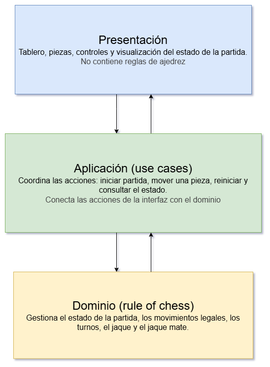

# Arquitectura

## 1. Visión general

Chess Game utiliza una arquitectura en capas para separar las responsabilidades de la presentación, la aplicación y el dominio.

Esta separación permite mantener la lógica del ajedrez independiente de la interfaz, facilita las pruebas y mejora la mantenibilidad del sistema.

## 2. Estilo arquitectónico

Se adopta una arquitectura en capas (Layered Architecture), organizada en tres capas principales.

- *Presentación*: gestiona la interfaz y la interacción con los jugadores.
- *Aplicación*: coordina los casos de uso y las operaciones de la partida.
- *Dominio*: concentra la lógica y las reglas del ajedrez.

Cada capa tiene responsabilidades definidas y se comunica con las demás respetando las reglas de dependencia establecidas.

## 3. Diagrama de arquitectura

El diagrama presenta las capas del sistema, sus responsabilidades y las relaciones entre ellas.

## 4. Capas arquitectónicas

### 4.1. Presentación

Es responsable de mostrar el tablero, las piezas, los turnos y el estado de la partida, además de capturar las acciones de los jugadores.

**Responsabilidades**

- Renderizar el tablero y sus componentes visuales.
- Capturar las acciones de los jugadores.
- Mostrar el estado y los resultados de las operaciones.
- Comunicar las acciones del usuario a la capa de aplicación.

Esta capa no contiene las reglas del ajedrez ni accede directamente al motor de reglas.

### 4.2. Aplicación

Es responsable de coordinar los casos de uso y conectar las acciones con la lógica del dominio.

**Responsabilidades**

- Iniciar y reiniciar una partida.
- Gestionar las solicitudes de movimientos
- Consultar el estado actual de la partida
- Coordinar las operaciones necesarias para actualizra la información presentada

Esta capa no implementa las reglas del ajedrez, delega su ejecución a la capa de dominio

### 4.3. Dominio

Es responsable de representar y gestionar la lógica de la partida de ajedrez

**Responsabilidades**

- Mantener el estado de la partida
- Validar los movimientos, según las reglas del ajedrez
- Gestionar los turnos
- Identificar situaciones como jaque, jaque mate y tablas
- Proporcionar la información necesaria para determinar el resultado de las operaciones

El acceso al motor de reglas se centraliza en esta capa para e vitar que sus detalles de implementación se propaguen a las demás capas

## 5. Reglas de dependencia

La arquitectura establece las siguientes reglas:

1. La capa de presentación solicita operaciones a la capa de aplicación.
2. La capa de aplicación coordina los casos de uso y utiliza la capa de dominion para ejecutar la lógica de la pantalla.
3. La capa de dominio no depende de las capas de aplicación ni de presentación.
4. La capa de presentación no accede directamente al motor de reglas.

Estas reglas permiten probar la lógica del dominio sin depender de la interfaz y reducen el acoplamiento entre las capas.

## 6. Consideraciones de diseño

La arquitectura prioriza la separación de responsabilidades y la simplicidad, evitando introducir abstraciciones que no aporte un beneficio claro.

Las dependencias externas se mantienen centralizadas para limitar su impacto sobre el resto del sistema. Si la evolución del proyecto lo justifica, podrán incorporarse mecanismos de abstracción que permitan sustituir dichas dependencias con cambios controlados.

La solución busca mantener un equilibrio entre simplicidad, facilidad de prueba y mantenibilidad, sin añadir complejidad innecesaria.
